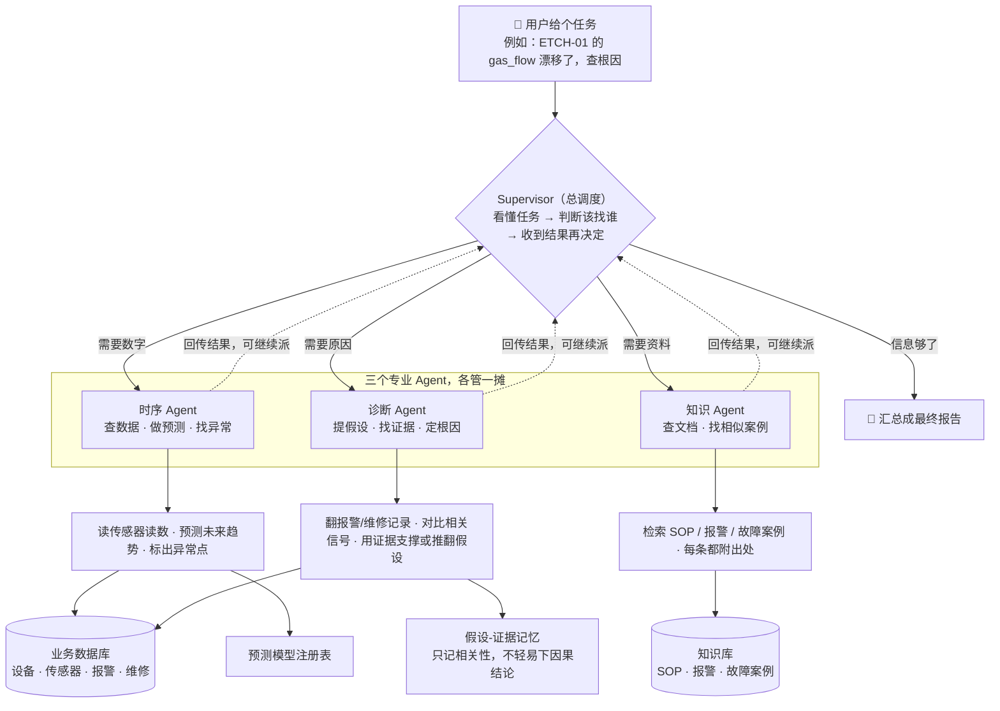

# FabPilot

**面向工业时序预测与故障诊断的假设驱动多 agent 系统**

FabPilot 是一个面向半导体晶圆厂（fab）设备的分层多 agent 系统（LangGraph）。它把
时序预测、异常检测、假设驱动的根因诊断和检索增强推理统一整合在一个 Supervisor 之下。
其灵感来自三星公开描述的 *半导体缺陷 agent* ——「先提出一个假设，再让证据来决定」的
模式 —— 面向工业遥测数据重新实现，不含任何专有代码。

> **严谨的因果边界：** 信号之间的相关性只作为证据，绝不会被直接当作因果关系下结论——
> 这让诊断结果更可信、可追溯。

---

## 亮点

- **动态路由，而非固定流水线** —— Supervisor 运行自己的 ReAct
  循环，在运行时决定委托给谁、按什么顺序。
- **真正的假设-证据记忆** —— 确定性的状态转换
  （`candidate → active → supported/refuted/inconclusive`），以记忆
  工具的形式实现，而非仅靠 prompt 的空口声明。
- **时序预测可插拔** —— 通过 Forecast 模型注册表接入多种模型
  （PatchTST、iTransformer、统计基线等），无需改动 agent 逻辑。
- **工具直连真实实现** —— 经过类型校验的工具直接对真实的
  数据库、预测模型注册表和知识库运行，没有占位实现。
- **混合 RAG 检索** —— 稠密（hash-embedding）+ 稀疏（BM25）检索，配合 RRF
  融合、重排序与来源引用。
- **可量化评估** —— 3 种配置 × 4 个场景，9 个指标类别都基于
  真实工具输出计算（留出的预测残差、注入的异常标签）。
- **默认使用 DeepSeek** —— 兼容任意 OpenAI 兼容 LLM；确定性的
  `FakeLLM`/`ScriptedLLM` 让测试和评估完全离线运行。

## 架构



完整的拓扑结构、agent 边界、ReAct 循环和持久化模型请参阅
[docs/architecture.md](docs/architecture.md)。

## 快速开始

```bash
# 1. 安装
pip install -e ".[ui,charts,dev]"

# 2. 配置（先复制，再填入你的 DeepSeek key——切勿提交 .env）
cp .env.example .env

# 3. 启动 Postgres（或将 FABPILOT_DATABASE_URL 设为 SQLite 地址）
docker compose up -d postgres

# 4. 建表 + 填充合成数据
fabpilot init-db
fabpilot seed

# 5. 通过 agent 系统运行一个任务
fabpilot run "ETCH-01 的 gas_flow 最近出现漂移，请诊断根因并给出处置建议。"

# 6. API / UI / 评估
fabpilot api          # http://localhost:8000/docs
fabpilot ui           # http://localhost:8501
fabpilot eval         # 写出 data/reports/evaluation.md + .json
```

还没有 DeepSeek key？数据 / 分析端点和评估框架无需 key 即可运行；
只有 `fabpilot run` / `/tasks` 端点需要 LLM。

## 项目结构

```
fabpilot/
├── agents/          # Supervisor + 3 个专业 agent（共用 ReAct 循环）
├── api/             # FastAPI 应用、路由、schema、服务
├── data/            # SQLAlchemy 模型、查询、合成数据生成器、seed
├── eval/            # 场景、ScriptedLLM、指标、runner、报告
├── forecasting/     # 预测模型协议 + 模型注册表（可插拔多模型）
├── llm/             # OpenAI 兼容 + 确定性替身
├── memory/          # 假设-证据记忆、checkpointer、会话存储
├── rag/             # 混合检索器（稠密+BM25、RRF）、嵌入器、向量库
├── state/           # 共享 AgentState + diff
├── tools/           # ToolRegistry + data/timeseries/knowledge/memory/general tools
├── ui/              # Streamlit UI
└── workflows/       # LangGraph 组装
knowledge_base/      # 示例 SOP / alarm / fault-case 文档
docs/                # 架构、API、评估、调研
tests/               # pytest 测试套件
scripts/             # 薄入口封装
```

## Agent 边界

| Agent      | 负责                                        | **不**负责   |
| ---------- | ------------------------------------------- | ------------------ |
| Supervisor | 任务分解、委托顺序、最终报告                | 分析、诊断、检索   |
| 时序 Agent  | 预测、异常检测、相关性、滞后、统计          | 根因、因果性结论   |
| 诊断 Agent  | 假设、证据、重新评估、根因                  | 原始检索、模型训练 |
| 知识 Agent  | 带引用的文档 / 案例检索                     | 解读               |

## 配置

所有设置都使用 `FABPILOT_` 环境变量前缀（参见 [`.env.example`](.env.example)）。
关键项如下：

| Variable                            | 默认值                          | 用途                              |
| ----------------------------------- | ------------------------------- | --------------------------------- |
| `FABPILOT_LLM_PROVIDER`           | `openai_compatible`           | `openai_compatible` 或 `fake` |
| `FABPILOT_LLM_BASE_URL`           | `https://api.deepseek.com/v1` | LLM 端点                          |
| `FABPILOT_LLM_API_KEY`            | *（空）*                      | 你的 key —— 切勿提交            |
| `FABPILOT_DATABASE_URL`           | Postgres URL                    | 业务 DB（SQLite 也可用）          |
| `FABPILOT_EMBEDDING_PROVIDER`     | `hash`                        | 离线确定性嵌入                   |
| `FABPILOT_DEFAULT_FORECAST_MODEL` | `statistical_baseline`        | 默认预测模型                      |

## 测试

```bash
pytest -q
```

该测试套件覆盖假设状态机、预测模型注册表、RAG 检索/分块、共享状态
diffing、工具目录完整性、指标/报告渲染，以及基于已填充种子数据的
SQLite 数据库的端到端工具集成。

## 出处

灵感来自三星半导体缺陷 agent 的公开描述，以及
[ragent](https://github.com/infiniflow/ragent) 的混合检索设计。
参见 [docs/research.md](docs/research.md)。

## 许可证

Apache-2.0
