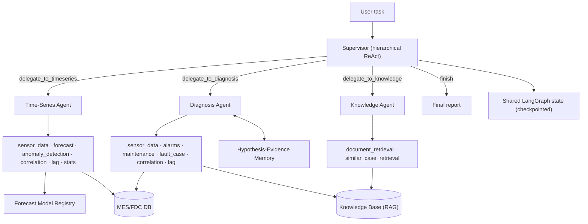

# FabPilot

**Hypothesis-Driven Multi-Agent System for Industrial Time-Series Analysis and Fault Diagnosis**

FabPilot is a hierarchical multi-agent system (LangGraph) for semiconductor
fab equipment. It combines time-series forecasting, anomaly detection,
hypothesis-driven root-cause diagnosis, and retrieval-augmented reasoning behind
a single Supervisor. It is inspired by Samsung's publicly-described
*semiconductor defect agent* — the "name a hypothesis, then let evidence decide"
pattern — reimplemented for industrial telemetry, with no proprietary code.

> **Boundary honesty:** forecasting is a *pure regression* (a real statistical
> baseline runs end-to-end; PatchTST/iTransformer are interface-only adapters),
> and **correlation is never reported as causation**. These are the two lines the
> whole design enforces.

---

## Highlights

- **Dynamic routing, not a fixed pipeline** — the Supervisor runs its own ReAct
  loop and decides delegation order at runtime.
- **Real Hypothesis-Evidence Memory** — deterministic status transitions
  (`candidate → active → supported/refuted/inconclusive`), implemented as memory
  *tools*, not prompt-only claims.
- **Tools connect to real internals** — typed, validated tools run against a real
  database, forecast registry and knowledge base. No `pass` placeholders.
- **RAG** — hybrid dense (hash-embedding) + sparse (BM25) retrieval with RRF
  fusion, rerank, and source citations.
- **Evaluation** — 3 configs × 4 scenarios, 9 metric categories computed from
  *real* tool outputs (held-out forecast residuals, injected anomaly labels).
- **DeepSeek by default** — any OpenAI-compatible LLM; a deterministic
  `FakeLLM`/`ScriptedLLM` makes tests and eval fully offline.

## Architecture



See [docs/architecture.md](docs/architecture.md) for the full topology, agent
boundaries, ReAct loop and persistence model.

## Quick start

```bash
# 1. Install
pip install -e ".[ui,charts,dev]"

# 2. Configure (copy, then fill in your DeepSeek key — never commit .env)
cp .env.example .env

# 3. Start Postgres (or set FABPILOT_DATABASE_URL to a SQLite URL)
docker compose up -d postgres

# 4. Create tables + seed synthetic data
fabpilot init-db
fabpilot seed

# 5. Run a task through the agent system
fabpilot run "ETCH-01 的 gas_flow 最近出现漂移，请诊断根因并给出处置建议。"

# 6. API / UI / evaluation
fabpilot api          # http://localhost:8000/docs
fabpilot ui           # http://localhost:8501
fabpilot eval         # writes data/reports/evaluation.md + .json
```

No DeepSeek key yet? The data/analytics endpoints and the evaluation harness work
without one; only `fabpilot run` / the `/tasks` endpoint need an LLM.

## Project structure

```
fabpilot/
├── agents/          # Supervisor + 3 specialist agents (shared ReAct loop)
├── api/             # FastAPI app, routes, schemas, service
├── data/            # SQLAlchemy models, queries, synthetic generator, seed
├── eval/            # scenarios, ScriptedLLM, metrics, runner, report
├── forecasting/     # ForecastModel protocol, real baseline, adapter skeletons
├── llm/             # OpenAI-compatible + deterministic fakes
├── memory/          # Hypothesis-Evidence Memory, checkpointer, session store
├── rag/             # hybrid retriever (dense+BM25, RRF), embedder, vector store
├── state/           # shared AgentState + diff
├── tools/           # ToolRegistry + data/timeseries/knowledge/memory/general tools
├── ui/              # Streamlit UI
└── workflows/       # LangGraph assembly
knowledge_base/      # sample SOP / alarm / fault-case documents
docs/                # architecture, API, evaluation, research
tests/               # pytest suite
scripts/             # thin entry-point wrappers
```

## Agent boundaries

| Agent | Owns | Does **not** own |
|---|---|---|
| Supervisor | Task decomposition, delegation order, final report | Analysis, diagnosis, retrieval |
| Time-Series | Forecast, anomaly *detection*, correlation, lag, stats | Root cause, causal claims |
| Diagnosis | Hypotheses, evidence, re-evaluation, root cause | Raw retrieval, model training |
| Knowledge | Document / case retrieval with citations | Interpretation |

## Configuration

All settings use the `FABPILOT_` env prefix (see [`.env.example`](.env.example)).
Key ones:

| Variable | Default | Purpose |
|---|---|---|
| `FABPILOT_LLM_PROVIDER` | `openai_compatible` | `openai_compatible` or `fake` |
| `FABPILOT_LLM_BASE_URL` | `https://api.deepseek.com/v1` | LLM endpoint |
| `FABPILOT_LLM_API_KEY` | *(empty)* | your key — never commit |
| `FABPILOT_DATABASE_URL` | Postgres URL | business DB (SQLite also works) |
| `FABPILOT_EMBEDDING_PROVIDER` | `hash` | offline deterministic embeddings |
| `FABPILOT_DEFAULT_FORECAST_MODEL` | `statistical_baseline` | default forecast model |

## What is real vs. interface-only

- **Real, runs end-to-end:** Supervisor/specialist ReAct loops, hypothesis-evidence
  memory, tool catalog, forecast statistical baseline, hybrid RAG, evaluation
  metrics, data generator, API, UI.
- **Interface-only skeletons:** `PatchTSTAdapter`, `iTransformerAdapter` raise
  `ForecastModelNotAvailable` until weights are loaded. They demonstrate the
  registry boundary but do not run a torch model (per project scope).
- **Deterministic test doubles:** `FakeLLM` / `ScriptedLLM` replace only the *LLM*
  in tests/eval; the tools they call are real.

## Testing

```bash
pytest -q
```

The suite covers the hypothesis state machine, forecast registry (real baseline +
adapter skeletons), RAG retrieval/chunking, shared state diffing, tool catalog
completeness, metric/report rendering, and end-to-end tool integration over a
seeded SQLite database.

## Attribution

Inspired by public descriptions of Samsung's semiconductor defect agent and the
hybrid-retrieval design of [ragent](https://github.com/infiniflow/ragent).
See [docs/research.md](docs/research.md).

## License

Apache-2.0
