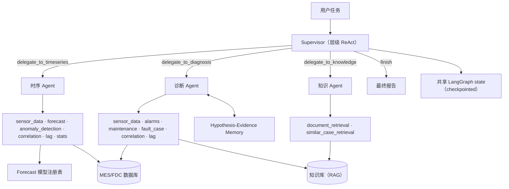

# FabPilot

**面向工业时序分析与故障诊断的 hypothesis 驱动多 agent 系统**

FabPilot 是一个面向半导体 fab 设备的分层多 agent 系统（LangGraph）。它把
time-series forecasting、anomaly detection、hypothesis 驱动的根因诊断和
retrieval-augmented reasoning 统一整合在一个 Supervisor 之后。其灵感来自三星公开描述的
*semiconductor defect agent* ——「先提出一个 hypothesis，再让证据来决定」的
模式 —— 面向工业遥测数据重新实现，不含任何专有代码。

> **边界诚实性：** forecasting 是 *纯回归*（真实的 statistical baseline 端到端运行；
> PatchTST/iTransformer 只是接口层的 adapter），并且 **correlation 绝不会被当作
> causation 报告**。这是整个设计所坚守的两条底线。

---

## 亮点

- **动态路由，而非固定 pipeline** —— Supervisor 运行自己的 ReAct
  循环，在运行时决定委托顺序。
- **真正的 Hypothesis-Evidence Memory** —— 确定性的状态转换
  （`candidate → active → supported/refuted/inconclusive`），以 memory
  *tools* 的形式实现，而非仅靠 prompt 的空口声明。
- **Tools 连接真实内部实现** —— 经过类型校验的 tools 针对真实的
  database、forecast registry 和 knowledge base 运行。没有任何 `pass` 占位符。
- **RAG** —— 混合 dense（hash-embedding）+ sparse（BM25）检索，配合 RRF
  融合、重排序与来源引用。
- **评估** —— 3 种配置 × 4 个场景，9 个指标类别都基于
  *真实* tool 输出计算（留出的 forecast 残差、注入的 anomaly 标签）。
- **默认使用 DeepSeek** —— 兼容任意 OpenAI 兼容 LLM；确定性的
  `FakeLLM`/`ScriptedLLM` 让测试和 eval 完全离线运行。

## 架构



完整的拓扑结构、agent 边界、ReAct 循环和持久化模型请参阅
[docs/architecture.md](docs/architecture.md)。

## 快速开始

```bash
# 1. 安装
pip install -e ".[ui,charts,dev]"

# 2. 配置（先复制，再填入你的 DeepSeek key——切勿提交 .env）
cp .env.example .env

# 3. 启动 Postgres（或将 FABPILOT_DATABASE_URL 设为 SQLite 地址）
docker compose up -d postgres

# 4. 建表 + 填充合成数据
fabpilot init-db
fabpilot seed

# 5. 通过 agent 系统运行一个任务
fabpilot run "ETCH-01 的 gas_flow 最近出现漂移，请诊断根因并给出处置建议。"

# 6. API / UI / 评估
fabpilot api          # http://localhost:8000/docs
fabpilot ui           # http://localhost:8501
fabpilot eval         # 写出 data/reports/evaluation.md + .json
```

还没有 DeepSeek key？data/analytics 端点和 evaluation 框架无需 key 即可运行；
只有 `fabpilot run` / `/tasks` 端点需要 LLM。

## 项目结构

```
fabpilot/
├── agents/          # Supervisor + 3 个专业 agent（共用 ReAct 循环）
├── api/             # FastAPI 应用、路由、schema、服务
├── data/            # SQLAlchemy 模型、查询、合成数据生成器、seed
├── eval/            # 场景、ScriptedLLM、指标、runner、报告
├── forecasting/     # ForecastModel 协议、真实 baseline、adapter 骨架
├── llm/             # OpenAI 兼容 + 确定性替身
├── memory/          # Hypothesis-Evidence Memory、checkpointer、会话存储
├── rag/             # 混合检索器（dense+BM25、RRF）、embedder、向量库
├── state/           # 共享 AgentState + diff
├── tools/           # ToolRegistry + data/timeseries/knowledge/memory/general tools
├── ui/              # Streamlit UI
└── workflows/       # LangGraph 组装
knowledge_base/      # 示例 SOP / alarm / fault-case 文档
docs/                # architecture、API、evaluation、research
tests/               # pytest 测试套件
scripts/             # 薄入口封装
```

## Agent 边界

| Agent       | 负责                                                    | **不**负责   |
| ----------- | ------------------------------------------------------- | ------------------ |
| Supervisor  | 任务分解、委托顺序、最终报告                            | 分析、诊断、检索   |
| Time-Series | Forecast、anomaly*detection*、correlation、lag、stats | 根因、因果性结论   |
| Diagnosis   | hypotheses、证据、重新评估、根因                        | 原始检索、模型训练 |
| Knowledge   | 带引用的文档 / 案例检索                                 | 解读               |

## 配置

所有设置都使用 `FABPILOT_` 环境变量前缀（参见 [`.env.example`](.env.example)）。
关键项如下：

| Variable                            | 默认值                          | 用途                              |
| ----------------------------------- | ------------------------------- | --------------------------------- |
| `FABPILOT_LLM_PROVIDER`           | `openai_compatible`           | `openai_compatible` 或 `fake` |
| `FABPILOT_LLM_BASE_URL`           | `https://api.deepseek.com/v1` | LLM 端点                          |
| `FABPILOT_LLM_API_KEY`            | *（空）*                      | 你的 key —— 切勿提交            |
| `FABPILOT_DATABASE_URL`           | Postgres URL                    | 业务 DB（SQLite 也可用）          |
| `FABPILOT_EMBEDDING_PROVIDER`     | `hash`                        | 离线确定性 embeddings             |
| `FABPILOT_DEFAULT_FORECAST_MODEL` | `statistical_baseline`        | 默认 forecast 模型                |

## 哪些是真实实现 vs 仅接口

- **真实、端到端运行：** Supervisor/专业 agent 的 ReAct 循环、hypothesis-evidence
  memory、tool catalog、forecast statistical baseline、混合 RAG、评估
  指标、数据生成器、API、UI。
- **仅接口的骨架：** `PatchTSTAdapter`、`iTransformerAdapter` 在加载权重之前会抛出
  `ForecastModelNotAvailable`。它们演示了 registry 的边界，但不会运行 torch 模型（按项目范围）。
- **确定性的测试替身：** `FakeLLM` / `ScriptedLLM` 只替换测试/eval 中的 *LLM*；
  它们调用的 tools 是真实的。

## 测试

```bash
pytest -q
```

该测试套件覆盖 hypothesis 状态机、forecast registry（真实 baseline +
adapter 骨架）、RAG 检索/chunking、共享状态 diffing、tool catalog
完整性、metric/报告渲染，以及基于已填充种子数据的 SQLite 数据库的端到端 tool 集成。

## 出处

灵感来自三星 semiconductor defect agent 的公开描述，以及
[ragent](https://github.com/infiniflow/ragent) 的混合检索设计。
参见 [docs/research.md](docs/research.md)。

## 许可证

Apache-2.0
