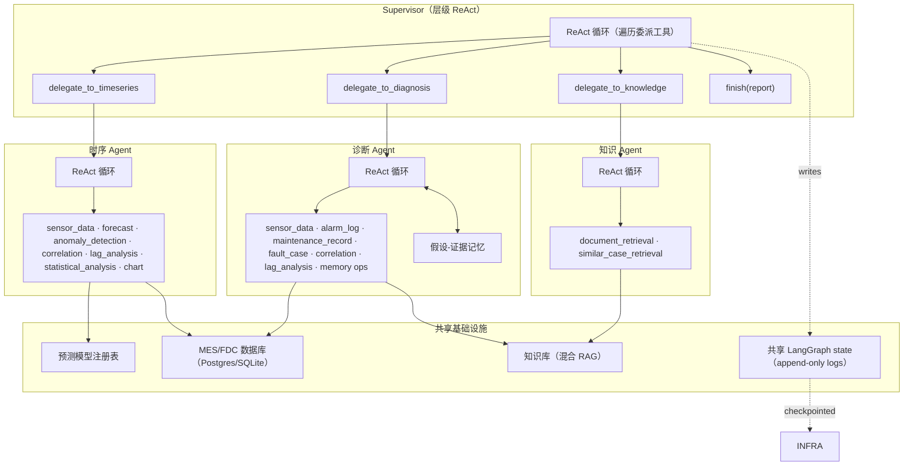

# FabPilot 架构

FabPilot 是一个面向工业时序预测和故障诊断的 **假设驱动的多 agent 系统**，
针对半导体 fab 设备（刻蚀腔室）。它是一个分层 LangGraph 系统：一个 Supervisor 通过
共享的、checkpointed 状态编排三个专业 agent。

## 设计原则

1. **动态路由，而非固定流水线。** Supervisor 运行自己的 ReAct
   循环，并在*运行时*决定委托给哪个专业 agent、按什么顺序。没有任何硬编码。
2. **真正的假设-证据记忆。** 诊断 Agent 的记忆是一个
   确定性的状态机（`candidate → active → supported / refuted /
   inconclusive`），而非仅靠 prompt 的声明。统计相关性被记录为
   *证据*，而绝不会被记录为已确认的因果。
3. **工具连接真实内部实现。** 每个工具都会校验类型化参数，并针对真实的
   数据库、预测模型注册表或知识库运行。执行路径中
   没有任何 `pass` 占位符。
4. **单一的预测模型边界。** 预测只负责输出数值，不包含
   任何异常解读；异常检测、统计和诊断都位于 agents 之中。

## 组件拓扑

## Agent 职责与边界

| Agent | 负责 | 明确**不**负责 |
|---|---|---|
| **Supervisor** | 任务分解、委托顺序、最终报告组装 | 数据分析、诊断、检索 —— 它只负责路由 |
| **时序** | 数值分析：查询、预测、异常检测、相关性、滞后、描述性统计、图表 | 根因推断、因果性结论 |
| **诊断** | 因果推理：假设生成、证据收集、假设重新评估、根因排序 | 原始检索、模型训练 |
| **知识** | 带引用的文档 / 相似案例检索 | 解读、诊断 |

这种划分落实了规范中 *预测 ≠ 异常分析* 以及 *相关性 ≠ 因果* 的要求：
时序 Agent 只返回「数字 + 异常」，而诊断 Agent 是唯一被允许把
证据转化为 supported/refuted 假设的组件。

## 共享状态

LangGraph 的 `AgentState` 是唯一事实来源。仅追加的日志字段
（`messages`、`tool_history`、`delegation_records`、`trace`、`errors`、
`subtasks`、`forecast_results`、`anomaly_results`、`retrieved_docs`）使用
`operator.add` reducer，因此每个节点的 delta 只携带*新增*的条目。
可替换的记忆字段（`hypotheses`、`evidence`、`pending_checks`）由
诊断 Agent 整体覆盖。

LangGraph checkpointer（`MemorySaver` 或 `SqliteSaver`）使运行可恢复，
并可通过 `thread_id` 检查。

## ReAct 循环与审计轨迹

每个 agent（包括 Supervisor）都运行一个共享的 `run_react_loop`，它会：

1. 把系统 prompt + 消息历史发送给 LLM。
2. 将响应解析为结构化的工具调用或停止信号。
3. 通过 `ToolRegistry` 执行每个工具（经过校验、异常安全）。
4. 将**决策摘要**（而非隐藏的思维链）以及工具结果
   追加到 trace 中。

预算（`supervisor_max_iterations`、`agent_max_iterations`、`tool_budget`）以及
一个循环检测窗口可以阻止失控循环。

## 预测模型注册表

单一的预测模型协议（`ForecastModel`，`request → ForecastResult`）由以下实现：

- `StatisticalBaselineModel` —— 统计基线模型：在 lookback 窗口上拟合线性趋势，
  并以约 95% 的预测区间进行外推。
- `PatchTSTAdapter`、`iTransformerAdapter` —— 深度时序模型
  （PatchTST / iTransformer）的接入点。

所有模型都通过同一个注册表接入，无需改动 agents；你也可以在注册表中
挂载自己的时序模型。

## RAG 检索流水线

混合检索（设计借鉴自 [ragent](https://github.com/infiniflow/ragent) 的
稠密 + 关键词并行召回、RRF 融合、重排 —— 用 Python 重新实现）：

1. `load_documents` 按段落对 markdown 进行分块，并带重叠；父目录即
   `doc_type`（`sop` / `alarm` / `fault_cases`）。
2. `HashEmbedder`（确定性的、离线）或 OpenAI 兼容的嵌入器
   生成稠密向量。
3. `HybridRetriever` 通过 RRF 融合稠密余弦相似度与 BM25，然后进行重排。
4. 每个命中结果都带有一个来源引用（`sop/mfc_flow_drift.md`，…）。

## 持久化

- 业务数据：基于 PostgreSQL（生产）或 SQLite（开发/测试）的 SQLAlchemy 2.0。
- 会话：JSON 文件的 `SessionStore`，用于 API 历史记录 + 最终报告。
- LangGraph checkpoints：`MemorySaver` / `SqliteSaver`。
